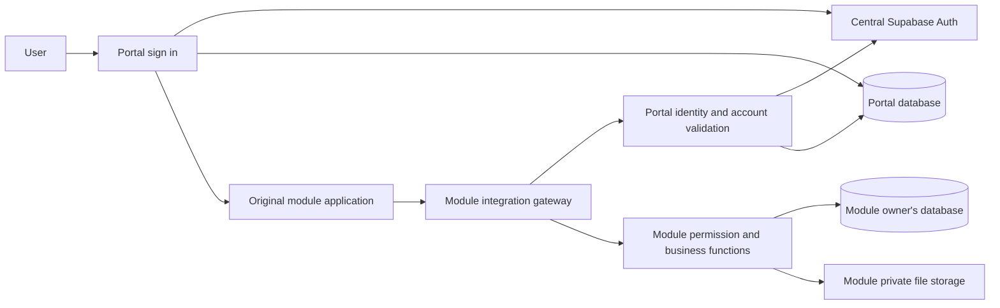

# TCMS Shared Software Design Specification

Version: 0.2.0 | Date: 11 November 2026 | Status: Draft for team review

Maintainer: Fernando Cossa (費南多), Portal and Integration Manager.
Applies to: the Portal, all four business modules, all their submodules, and supporting HR and administration workspaces.

## 1. Authority and approval

This revision implements the design direction in the Professor's meeting record dated 28 October 2026 and Fernando's subsequent requirements. It is documentation, not evidence that every requirement is implemented. No code, database, permission or deployment change is authorized by this document alone.

The Professor requires a shared identity, module-owned authorization, common standards and an end-to-end acceptance workflow. Separate databases, preservation of the owners' original applications, the protected System Owner and mandatory first-password change are project decisions confirmed by Fernando. The detailed integration mechanism below is a proposed technical baseline for team approval.

The team must review, revise and approve the draft before treating it as an official standard. Each module owner must then supply this version to their development assistant. Module specifications cannot override it. Wxx is the Professor's filename placeholder; the team must assign the teaching-week label. It does not assert the current teaching week.

## 2. Terminology and scope

| Term | Meaning |
|---|---|
| System | TCMS, the complete Tzu Chi Mozambique System |
| Portal | Shared identity, account lifecycle, sign-in and module entry application |
| Module or subsystem | One business area, with its own application, database and authorization owner |
| Submodule | A functional area within a module; inherits central identity and the module authorization boundary |
| Authentication | Establishing who a user is |
| Authorization | Deciding which operations and records that user may access |
| Application administrator | A person with explicitly assigned application permissions |
| Repository or Supabase collaborator | A development/infrastructure collaborator; this is separate from application authorization |

| Stable catalogue identity | Business area | Notes |
|---|---|---|
| TCMS0 | Portal | Shared entry point |
| TCMS1 | Information Management System (IMS) | Successor display name to Foundation Activities and Charitable Services in the meeting record |
| TCMS2 | Education and Vocational Training | Exact submodule inventory supplied by its owner |
| TCMS3 | Farm Management | Exact submodule inventory supplied by its owner |
| TCMS4 | Logistics and Warehouse Management | Item Movement belongs here; relationship to the earlier transport component must be documented |

HR (Human Resources / Recursos Humanos) and System Administration are supporting Portal workspaces, not an unapproved fifth or sixth business module. These catalogue identities do not mandate renaming existing deployed database objects.

## 3. Mandatory responsibility boundaries

| Responsibility | Portal owner | Module administrator |
|---|---|---|
| Create central identities | System Owner or authorized HR | May request account creation; cannot create separate module credentials |
| Passwords, sign-in and recovery | Portal Auth | Redirect to Portal; never ask for another module password |
| Global account state | Portal | Enforce the resulting global denial |
| Business roles and data scope | Display module-reported results | Define and assign within own module |
| Approve, reject or revoke module access | No ordinary business approval authority solely because of Portal administration | Responsible for own module |
| Business records and files | No central duplication by default | Responsible for storage and access control |
| Global settings | System Owner only | No authority |
| Shared contract | Fernando coordinates team review | Implement and report deviations |

Being a module administrator grants no rights in other modules. HR account creation grants no business access. New ordinary users have no business-module permissions.

Fernando's System Owner account has the explicitly agreed administrative exception in each module. Each module must provision a protected mapping for the exact verified central identity and audit it. This is not automatic elevation based on an email address, browser label or role name. Ordinary module administrators cannot create another System Owner or revoke the protected owner binding. Bootstrap or transfer of this binding is a separately reviewed maintenance procedure.

## 4. Separate databases with a single identity

Each module remains in its owner's Supabase project; the Portal has its own project. No business database is moved to Fernando's project as a prerequisite for integration. Each owner remains responsible for backups, migrations, storage and availability in their project.

The canonical identity is the pair `(identity_issuer, portal_user_id)`. The issuer identifies the trusted Portal Auth service; the user ID is its immutable UUID. Email is mutable display/contact information and must not be the authorization key. Local membership rows reference this identity logically: there is no cross-project PostgreSQL foreign key.

New integrated users do not need local module Auth accounts, passwords or registration. A module may maintain a non-credential membership/profile row. Existing local credentials and historical records must be inventoried and migrated through an approved plan. Legacy sign-in cannot remain a bypass around global suspension or module authorization in the accepted integrated release. Do not delete legacy data or identities simply to satisfy the design.

## 5. Single login and integration contract

The user supplies credentials only to the Portal. Opening an approved module must open the owner's original application without a second login, preserving its layout, styles, forms and operating workflow. Replacing it with a new Portal-hosted business interface does not satisfy acceptance.

Separate Supabase projects do not automatically share authentication. Proposed baseline: a module-owned server gateway validates the Portal session against the trusted Portal Auth service and current Portal access context, then applies local module authorization. Do not treat decoding a token or copying its user ID as verification.

The browser-to-gateway transport must be recorded for each module before activation. A Portal session broker using exact-origin and exact-window messaging is permitted as a transitional adapter. It must bind to the initial user, forward only supported operations, never expose refresh tokens to the module and stop after account switching. Its requirement to keep the Portal tab open must be disclosed. A later server-managed handoff/session design requires a reviewed contract and replay, expiry and logout tests; it is not assumed implemented.

Requirements for every protected request:

1. Validate the credential with the trusted issuer, including validity and expiry; derive the actor server-side.
2. Check active Portal account, completed first-password change and global access state. System Owner is the sole agreed global-lock exception.
3. Check active local membership, permission, submodule and record scope.
4. Validate input and concurrency controls; execute the approved function.
5. Return minimum necessary data and record an audit event where appropriate.

User IDs, roles, email or permission flags in caller input cannot establish the actor's authority. Origin checks are an additional boundary, not authentication. Central outages must block protected operations with a service-unavailable result, not report that the user has been rejected.

The first accepted version checks current central and local authorization for every protected operation. Card-state caches are display-only. Revocation or suspension takes effect on the next protected request after the decision commits. Changing this rule to cached authorization requires an explicit, bounded stale-access policy approved by the team.

### 5.1 Logical interfaces

These are contract capabilities, not claims that these endpoint names already exist. Every module supplies a mapping to actual endpoints and function signatures.

| Capability | Essential result or input |
|---|---|
| Identity context | Verified issuer, user ID, account state, password-change requirement, global access decision |
| Module access status | Stable module code, membership state, effective permissions, decision version, checked time |
| Request access | Optional reason; requester derived from verified session; duplicate requests handled idempotently |
| Review queue | Module-admin-only minimum identity details and current request version |
| Decide access | Target central identity, decision, role/scope, reason and expected version; actor derived server-side |
| Execute business operation | Allowlisted operation and validated payload, never arbitrary SQL or function forwarding |
| Health | Contract version and availability without exposing private records or secrets |

Responses distinguish `UNAUTHENTICATED`, `PASSWORD_CHANGE_REQUIRED`, `ACCOUNT_DISABLED`, `GLOBAL_LOCKED`, `ACCESS_PENDING`, `ACCESS_DENIED`, `VALIDATION_ERROR`, `CONFLICT` and `SERVICE_UNAVAILABLE`. Use standard HTTP status semantics and a correlation ID; do not return stack traces or credentials. Unauthenticated requests return 401, authenticated denials 403, conflicts 409 and dependency outages 503. Successful access-status queries may return a denied/pending state without being transport errors.

## 6. Module and submodule authorization

Common membership lifecycle: none → pending → approved or rejected; approved → suspended or revoked. A new review may restore access only through an authorized decision. Rejection never creates an active membership. Concurrent decisions must detect stale versions and audit changes atomically.

Permissions use explicit capabilities such as `logistics.items.read`, `logistics.movements.create` and `ims.activities.approve`. These are examples, not imposed business role names. Each owner must define a role-to-permission matrix and data scope. Numeric levels are not assumed comparable across modules.

Submodule access requires active parent-module access AND an explicit permitted capability; access to one submodule does not imply all siblings. A parent-module suspension blocks its submodules. Delegation of submodule administration must be explicit and cannot grant capabilities beyond the grantor's allowed delegation scope. No user can approve their own elevation. Module administrators may manage memberships within their module but not the protected owner binding.

The catalogue may display all four modules to authenticated users, with distinct states for not integrated, unavailable, not authorized, pending, rejected, suspended and available. Visible cards do not authorize operations. Server controls must reject direct URLs, forged requests and access to another user's records.

## 7. Data and security standards

Enable RLS (Row Level Security / Segurança ao Nível das Linhas) on exposed tables. Business access uses reviewed RPCs (Remote Procedure Calls / Chamadas de Procedimentos Remotos) or a gateway invoking those functions. No raw SQL in browser HTML, CSS or JavaScript. Auth and authorized file transfers use the appropriate service APIs.

Privileged service credentials stay in server-side secrets. A service-role gateway can bypass RLS; therefore RLS alone does not prove its safety. Restrict privileged function execution, verify actor and operation before dispatch and test the gateway and direct database paths independently. Fix function search paths and avoid dynamic arbitrary SQL. Public clients contain only approved public configuration. Never share project signing secrets to make separate projects trust each other.

Use UUIDs for central identity references; timestamps in UTC with explicit Mozambique-time presentation where appropriate; foreign keys within a database; uniqueness and validation constraints for business invariants. Use transactions for multi-step business changes. New naming proposal: lowercase snake_case, documented module prefixes and versioned migrations. Preserve deployed naming through documented compatibility mappings rather than mass renaming.

Files remain under module ownership. Private files require permission checks for upload and download; signed links have short documented expiry. Revocation tests must consider already-issued links. Use file type/size limits and object-level authorization. Permanent deletion, retention periods and backup schedules need owner-approved policies; archive/restore remains the IMS scope currently agreed.

Audit events record actor issuer/ID, target, module/submodule, action, result, reason, timestamp, correlation ID and relevant version. Do not log passwords, tokens or complete sensitive payloads. Ordinary users cannot rewrite audit records. Retention and authorized audit readers must be specified by each owner before operational acceptance.

## 8. Interface and development standards

Preserve each original business application's UI/UX (User Interface/User Experience / Interface e Experiência do Utilizador). Shared standards cover understandable labels, keyboard access, errors, confirmation, identity display and return-to-Portal behavior, not mandatory replacement layouts. Agree any visual changes with the module owner. Portal supports EN, PT and Traditional Chinese (中文), plus light/dark/system appearance. Modules declare supported languages and theme behavior; integration must not silently remove existing choices.

Use Save for persistence, Submit for workflow decisions, Cancel to abandon edits and Back to Portal for navigation. Show text alongside status colors, keep validation near fields, preserve input on failures and prevent accidental duplicate submissions. A module return action is not global logout; the label must say so. Global Sign out invalidates the Portal session and prevents subsequent protected module operations under the revocation contract.

Each repository has a responsible maintainer. Fernando has access for integration; colleagues do not automatically receive access to one another's repositories. Access to source is distinct from write/deploy permissions. Proposed workflow: feature branches, focused commits, pull requests reviewed by the owner, passing checks before merge, tagged release/commit evidence and migration/deployment order. Urgent exceptions must be documented. Do not commit secrets, production exports or personal test data.

## 9. Handover and operation

Each owner supplies repository and live URLs, project reference, authorized collaboration, current commit, module SDS, submodule inventory, schema/migrations, actual function contracts, permission matrix, legacy-login plan, synthetic test accounts/data, test evidence, deployment order, rollback/restore plan and support contact. Secrets are configured through authorized server settings, never handover documents.

Fernando supplies central identity/context semantics, catalogue and navigation contract, permitted Portal origins, common error/version conventions and integration tests. Owners configure and verify their gateways and memberships. Both sides sign acceptance; a shared database is not a prerequisite.

Deploy additive compatibility changes first, verify backups before migrations and preserve historical identifiers. A module outage must not prevent entry to other healthy modules. Use request timeouts, bounded retries for safe reads and idempotency for retries of writes. Monitor health and correlate errors across projects. Rollback must preserve committed business data, not assume that reverting frontend code reverses a database migration.

## 10. Acceptance matrix

All entries below are required test cases, not reported passes. Record environment, date, commit, actor role, expected/actual result and evidence.

| ID | Test and required result |
|---|---|
| C01 | HR/Owner creates a central identity; first login and mandatory password change succeed |
| C02 | Fresh ordinary account cannot enter any of the four modules or call their protected functions |
| C03 | Module administrator assigns a role; only that module becomes available in Portal |
| C04 | Entry opens the original application with no module password or registration |
| C05 | Allowed read and write work; forbidden administration and out-of-scope records are denied |
| C06 | Other modules and unauthorized submodules remain blocked |
| C07 | Revoke membership or change role; next request uses the new decision |
| C08 | Suspend central account or enable global lock; modules deny access, with only the Owner lock exception |
| C09 | Expired/forged/wrong-issuer token, forged actor, direct database call and stale decision are denied |
| C10 | Sign out or switch Portal accounts; old module context cannot keep operating |
| C11 | Central or module outage produces a clear unavailable state without accidental grants |
| C12 | Protected files and links follow the documented access and expiry rules |
| C13 | Existing business records and original UI remain preserved after integration |
| C14 | Public build and repository changes contain no secrets; browser assets contain no SQL |

## 11. Approval and open decisions

Confirmed project direction: single Portal login; separate module databases; local authorization; preserved original applications. Team ratification remains required for the detailed shared standard.

Resolve before release: role matrices and submodule inventory per owner; exact gateway contracts and transport; migration of legacy logins; secure account recovery; audit retention, backups and recovery objectives; operational support and final week label. These are explicit decisions, not permission to leave access checks optional.

Approval record: Fernando ___; TCMS1 owner ___; TCMS2 owner ___; TCMS3 owner ___; TCMS4 owner ___; Professor review ___; approved version/date ___.

## 12. Glossary and sources

SDS: Software Design Specification / Especificação de Desenho do Software. Auth: Authentication / Autenticação. HR: Human Resources / Recursos Humanos. UUID: Universally Unique Identifier / Identificador Universalmente Único. JWT: JSON Web Token / Token Web em JSON. API: Application Programming Interface / Interface de Programação de Aplicações. SQL: Structured Query Language / Linguagem de Consulta Estruturada. PR: Pull Request / Pedido de Integração de Alterações. SSO: Single Sign-On / Autenticação Única; this document requires the user experience, not a claim that enterprise SAML SSO is configured.

Primary project source: 20261028 TCMS_Project_Meeting_Record_English_First.pdf, pages 1–5; user decisions in this conversation through 11 November 2026. The meeting record uses SDS without defining its expansion; the expansion above is the proposed project convention.

Technical references: [Supabase JWT documentation](https://supabase.com/docs/guides/auth/jwts) for token validation; [Supabase RLS documentation](https://supabase.com/docs/guides/database/postgres/row-level-security) for row policies and privileged-service limitations. The cross-project architecture is a project design proposal, not a claim of automatic Supabase federation.

Revision 0.2.0 replaces conflicting architectural guidance in the earlier draft only after approval. The previous W01 files remain unchanged as history.

## Logistics submodule amendment of 11 November 2026

Fernando approved three TCMS4 submodules: Transportation, Item Movement (Warehouse), and Procurement. Each has its own explicit permissions; an approved Warehouse role does not grant Transportation or Procurement. The Logistics landing page is navigation, not an authorization grant.

Transportation reuses the existing fleet/request functions. Item Movement remains in the module owner's original application and database; Fernando expressly authorized its visual redesign on this date, superseding the earlier requirement to preserve its exact appearance for this submodule only. Its existing business operations and authorization checks remain in place. Other modules retain their original interfaces.

Procurement currently has a protected status page only. Purchasing workflows, schema, role matrix and operations are not implemented and are not advertised as available. They require the module owner's requirements and acceptance before activation. No Procurement permission is inherited from Warehouse, Transportation, HR or ordinary Portal membership.

Acceptance additions: independent Transportation/Warehouse eligibility; direct-route guards; clear Procurement unavailable state; Warehouse original RPC/role gates preserved; single Portal entry; responsive light/dark design and EN/PT/Traditional Chinese presentation. Backend localization and full interactive role tests must be recorded separately.
