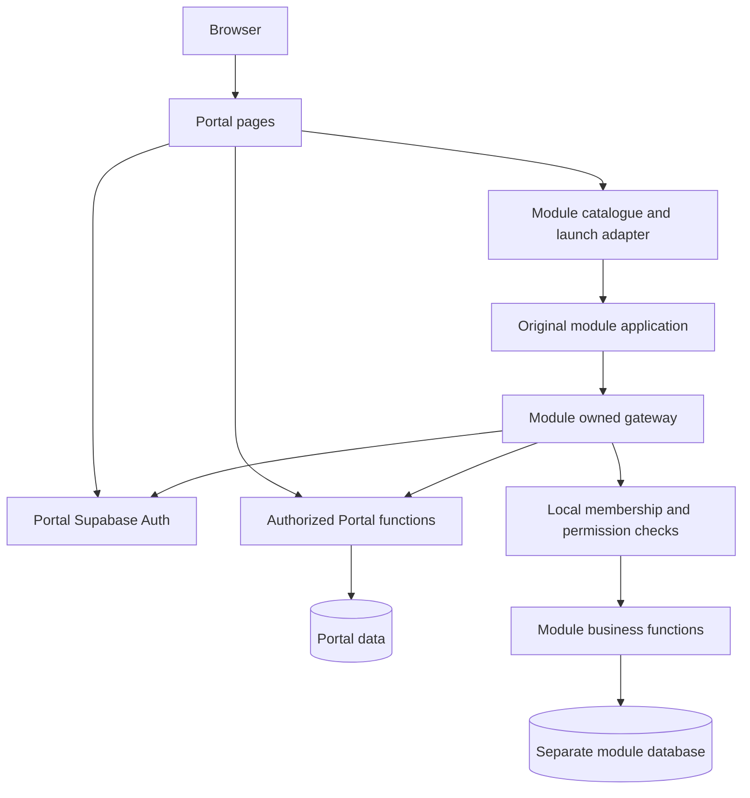
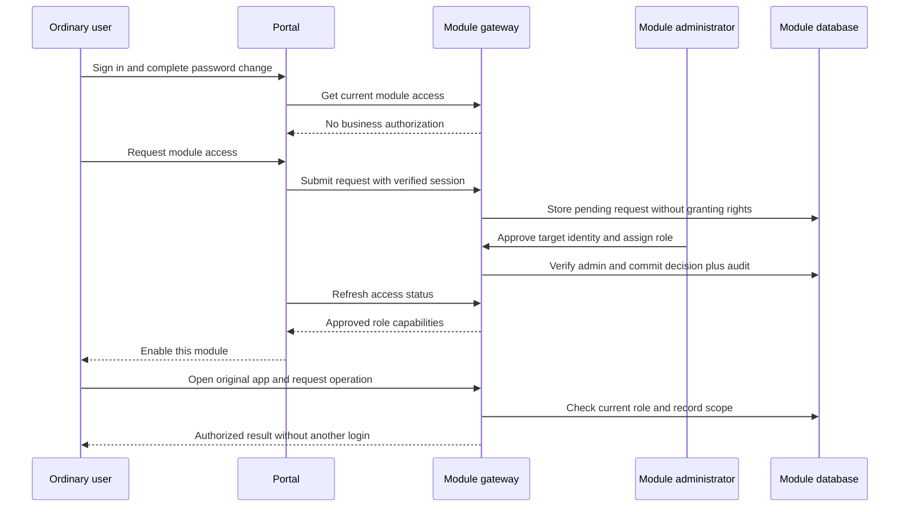
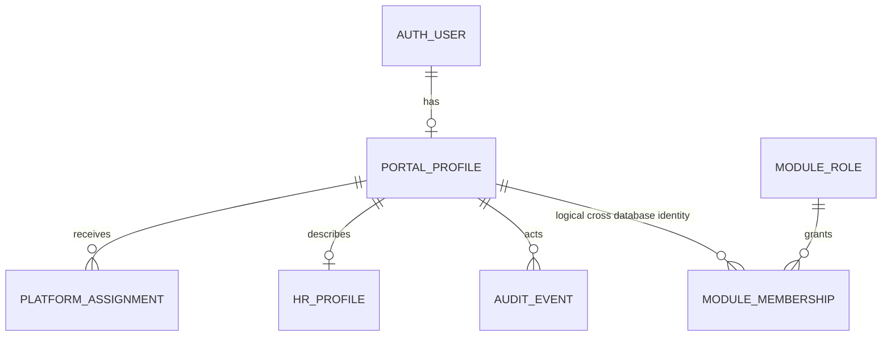

# TCMS Portal Software Design Specification

Version: 0.2.0 | Date: 11 November 2026 | Status: Draft for team review

Responsible: Fernando Cossa (費南多). Governing document: [TCMS shared SDS](SDS-TCMS-Main-Wxx.md), version 0.2.0. Wxx remains the unassigned teaching-week label. This revision changes documentation only and preserves the previous W01 draft.

## 1. Purpose and boundaries

The Portal is the only TCMS sign-in entry point. It manages central identity, internal account provisioning, first-password change, central account status and the catalogue of four independently operated business modules. It does not replace their original applications or become the authoritative store of their business roles or data.

The Portal has its own Supabase project. IMS, Education, Farm and Logistics retain separate projects administered by their owners. HR and System Administration are supporting Portal workspaces. HR account creation is in scope; payroll, recruitment, attendance and other comprehensive HR business functions are not implied by this specification.

The Professor's 28 October record confirms the earlier Portal requirements were met and establishes documentation and integration as the next priority. This is not certification of the current release. Requirements below describe the target, while section 10 identifies known gaps.

## 2. Actors and permissions

| Actor | Portal capabilities | Explicit limits |
|---|---|---|
| System Owner | Global settings, central accounts, HR eligibility, module registry, global lock and administrative audit | Business access uses explicit protected local module bindings, not an arbitrary frontend bypass |
| Authorized HR | Create ordinary identities and maintain permitted basic personnel fields | Cannot create Owner/admin privilege, assign module roles, modify integration secrets or change global settings |
| Module administrator | Ordinary Portal entry and access to their module's administration | No Portal settings access solely through module administration |
| Ordinary user | Sign in, change own password, see catalogue, request access and open approved modules | Cannot self-approve, grant permissions or access unapproved modules |
| Unauthenticated visitor | Sign-in and approved account-recovery flow | No protected catalogue, personnel or business data |

Fernando's HR account is separate from his System Owner account. HR eligibility must not restore transport-manager privileges. Existing account email addresses are identifiers for human reference only; authorization uses the verified issuer and central user ID.

System Administration is visible and callable only by the System Owner. Module-specific administration is shown only to that module's administrators. Hiding a card or button is presentation, not the enforcement boundary.

## 3. Functional requirements

| ID | Requirement |
|---|---|
| P01 | Provision accounts internally through Owner/HR; public self-registration excluded |
| P02 | Authenticate with Portal Supabase Auth; never store plaintext passwords in application tables |
| P03 | Require initial password change before protected module operations, enforced server-side |
| P04 | Show all four business modules and accurate integration/access states |
| P05 | Get module eligibility from its authoritative server, not a Portal-maintained duplicate role matrix |
| P06 | Open the approved original application without another login |
| P07 | Route access requests to the appropriate module administrator |
| P08 | Restrict global settings and global lock to Owner; lock affects everyone except Owner |
| P09 | Suspend accounts centrally and enforce suspension across modules |
| P10 | Support EN, PT, Traditional Chinese and light/dark/system appearance in Portal |
| P11 | Provide clear expiry, denial, outage, retry and return-to-Portal states |
| P12 | Audit privileged Portal actions and correlate integration failures |
| P13 | Provide controlled password recovery before normal organizational rollout |
| P14 | Preserve existing records and the original UI/UX of each module |

## 4. Architecture and trust

The gateway validates central identity and current global account eligibility before checking its own authorization. The Portal exposes only the minimum central context necessary; it does not supply module roles as authoritative claims. Browser state, cached cards and user-editable profile metadata cannot grant authority.

A module-owned server may use a privileged database credential internally, but then its own verified identity, operation and row-scope checks are mandatory. RLS remains enabled and direct client table access remains restricted. No secret is copied into Portal JavaScript, URLs or shared documents.

The initial broker transport used by Item Movement is transitional: the Portal keeps its own session and forwards allowed requests to the module gateway using exact-origin/window checks. It is bound to the initial account and requires the launch tab to remain open. Acceptance must demonstrate no second login. User-reported second-login behavior is an open defect, even though an earlier Owner test succeeded. The exact failure route must be reproduced after document approval.

## 5. Operating workflows

### 5.1 Internal creation and first login

1. Owner or authorized HR submits required name and email through the internal account interface.
2. The server verifies provisioning authority and creates the identity through the central Auth administrative service; the browser never receives its privileged key.
3. Create a Portal profile with an initial-password-change requirement and no business permissions. Account creation must be idempotent and recover cleanly if Auth succeeds but profile provisioning fails.
4. Deliver temporary access through an approved private channel; never record the password in audit logs or source files.
5. User signs in at Portal and is sent to the dedicated password-change page.
6. Complete the password change through Auth. Clear the initial-change requirement only through a trusted confirmation flow; users must not be able to clear a profile flag directly.
7. The user reaches the catalogue. Direct module navigation before this point must remain denied.

Temporary-credential delivery and account-recovery mechanisms require a documented operational choice. Email configuration remains an open dependency; this draft does not claim working delivery.

### 5.2 Module approval and entry

An administrator may directly add an existing central identity when business needs justify it; a self-service request is not mandatory. In either flow the module owns the decision. Approving IMS does not activate Education, Farm or Logistics. Submodule capabilities follow the shared SDS.

### 5.3 Account, access and session changes

Module revocation changes only the relevant membership. Central suspension blocks every module. Global lock blocks all ordinary users, including module administrators and HR, but not the protected System Owner. Record who changed the state, why and when.

Refresh catalogue status after decisions and when returning to the homepage. Every protected operation still validates live central and local status. Closing a module is not logout. Global Sign out must prevent later protected requests; any already-issued access token or file link requires the explicit revocation/expiry behavior defined in the shared contract. An old broker must reject requests after a different account signs in.

### 5.4 Dependency failure

If one module fails, show its unavailable state and preserve access to other healthy modules. If central identity or global status cannot be verified, refuse protected module operations until verification recovers. Preserve unsent form data where safe and avoid resubmitting writes blindly. A timeout must not be displayed as administrator rejection.

## 6. Portal data design

This is a logical design, not an executed migration or an exact inventory of deployed column names. The implementation mapping must be verified against migrations before coding.

| Logical entity | Key and essential fields | Ownership |
|---|---|---|
| Auth user | UUID user_id; Auth-managed credentials/session identity | Central Supabase Auth |
| Profile | user_id PK/FK; display_name text; account_status text; password_change_required boolean; version integer; timestamps | Portal |
| Platform assignment | assignment ID; user_id FK; capability/role; active; authorizer; timestamps | Portal; controls Portal only |
| Module registry | stable module_code PK; display-name translations; owner; trusted application origin; entry URL; gateway URL; contract version; integration state | Owner-controlled Portal configuration |
| System setting | setting_key PK; controlled value; changed_by; reason; version; timestamp | Owner only |
| HR profile | user_id PK/FK; department; position; version; timestamps | HR-controlled approved fields |
| Provisioning request | request ID; idempotency key UQ; actor; resulting user_id; status; sanitized error; timestamps | Portal server |
| Audit event | event ID; actor ID; target; action; result; reason; correlation ID; timestamp | Append-only protected history |

Module membership belongs in each module database: issuer, portal_user_id, local role, submodule/data scope, state, decision actor/time and version. The Portal may cache a minimal status for display but cannot turn that cache into a permission grant. Do not mirror passwords or complete business records.

The last two entities reside in module databases; the cross-database line is logical, not a physical foreign key. A profile may be temporarily absent after failed provisioning, hence the recovery requirement.

Existing names observed in earlier documentation include `core_profiles`, `core_platform_roles`, `core_system_settings`, `core_audit_events`, `core_modules`, `core_hr_access`, `hr_employees` and `hr_account_requests`. Existing Portal-held module permissions require reconciliation with local module authority; do not silently remove or assume they already conform.

## 7. Integration configuration and interface rules

For each module, record the exact repository, published application URL, project reference, gateway, trusted origins, contract version, supported operations, responsible owner, role matrix, local identity mapping and integration test evidence. Only Owner changes this configuration. Validate entry destinations against approved HTTPS origins; development localhost entries are separate and never silently become production redirects.

The Portal provides current identity/global context and first-password-change status. The module provides current membership and permissions. In existing code `core_get_my_context` and module `portal-bridge` functions are candidates to map these capabilities; this draft does not promise identical contracts across projects.

No module gets another module's credentials. No broad proxy, arbitrary destination or arbitrary RPC name is accepted from browser input. All cross-window messages require exact expected origin, source window, correlation ID and timeout. No authentication material in query strings or fragments. Browser controls alone never replace server checks.

## 8. Portal interface specification

| Screen | Required behavior |
|---|---|
| Sign in | TCMS/Tzu Chi Mozambique identity, credentials, language/theme; no open public registration |
| Change initial password | Dedicated page; no normal module entry until completed |
| Home | Four business cards with accessible status and next action; Owner-only System Administration; HR workspace only for authorized staff |
| Access request | Name of destination module, reason where required, confirmation of pending state; no automatic grant |
| HR | Internal account creation and approved directory maintenance only |
| System Administration | Global settings, central account state, registry and audit under Owner controls |
| Module launch | Validate status, open the original application, explain any transitional tab requirement |
| Recovery | Approved recovery process and invalid/expired-link handling; availability depends on completed configuration |

Use clear field labels, keyboard focus, responsive layout, readable contrast, localized dates and messages. EN/PT/中文 and appearance preferences are not authorization state. Preserve original module themes and translations; any cross-module preference propagation is optional until agreed with each owner. Do not mark unavailable modules as functioning or display fabricated activity statistics.

## 9. Verification plan

Use synthetic accounts and records, record exact environments and commits, and distinguish automated checks from live browser evidence. These are planned acceptance criteria, not new test results.

| ID | Scenario | Expected result |
|---|---|---|
| P-T01 | Owner and HR create ordinary accounts; Member attempts creation | First two allowed, Member denied; no role elevation |
| P-T02 | Fresh login; direct module request before password change | Password-change page required and module request denied |
| P-T03 | New account enters catalogue | Four modules visible; all protected business operations denied |
| P-T04 | IMS admin approves a role; user refreshes | Only IMS enabled, with no second login in original app |
| P-T05 | Repeat P-T04 for each other module independently | Each local administrator controls only their own permissions |
| P-T06 | Test permitted write and forbidden admin operation | Permission matrix enforced server-side |
| P-T07 | Revoke module access then reuse open app | Next protected operation denied |
| P-T08 | Central suspension/global lock | All ordinary access denied; Owner lock exception works |
| P-T09 | Sign out, switch user or expire session | Old app cannot act as former or newly signed-in account |
| P-T10 | Forged user/role/origin, direct endpoint or wrong-project token | No unauthorized data or operation |
| P-T11 | Module outage versus central outage | Accurate unavailable states, no accidental access |
| P-T12 | Language, theme, keyboard and small-screen checks | Portal remains usable; original module interface preserved |
| P-T13 | Review published assets | No secret keys or browser SQL |
| P-T14 | Recovery and partial provisioning failure | Safe retry, no duplicate identities, recovery flow verified |

For the Professor's demonstration: create user → first login/change → all modules denied → one module administrator assigns role → one module opens without login → allowed operation succeeds → forbidden administration and other modules remain denied. Include screenshots and a short expected/actual test record.

## 10. Known implementation position and gaps

This section summarizes prior project evidence and user reports; no new system audit or code execution was performed to prepare these SDS files.

| Area | Position |
|---|---|
| Portal entry, internal creation and initial password change | Previously implemented and exercised; rerun against the approved SDS |
| IMS approval and ordinary-user restrictions | Previously tested; preservation of the original IMS application remains pending |
| Item Movement original application | Integration published and Owner read/create tested previously; user now reports a second-login path, so single-login acceptance is open |
| Item Movement ordinary account and editing | Complete native-browser acceptance still pending |
| Separate projects | Confirmed project architecture; verify each module's contract individually |
| Education and Farm | Full integration acceptance not established |
| Email and password recovery | Deferred earlier; not accepted as complete |
| Shared standards | This revision is pending team approval |
| Logout, legacy-login bypasses, failure recovery | Require explicit cross-project regression tests |

A successful Owner demonstration cannot substitute for an ordinary-user test. Existing local credentials and replacement interfaces must be addressed without deleting historical data. Do not label the four-module system fully integrated until all required cases pass independently.

## 11. Delivery and approval

Implementation order after approval: confirm role/submodule contracts with owners; reconcile existing mappings; fix native single-login paths; verify live central/local enforcement; complete the ordinary-user demonstration for each module; finish recovery and operational procedures; publish the evidence and accepted document version.

Deployments require separate frontend, gateway and migration checks, compatibility with existing clients, data-preserving rollback and an owner-reviewed release. This document does not request any deployment now.

Review record: Fernando ___; HR workflow reviewer ___; each module owner ___; Professor review ___; approved version/date ___.

## 12. Sources and glossary

Primary requirement source: Professor's 20261028 TCMS_Project_Meeting_Record_English_First.pdf, especially sections 5–8. Additional requirements: Fernando's instructions for separate databases, single Portal login, module-owned authorization, original applications, Owner-only settings and mandatory first-password change.

SDS means Software Design Specification / Especificação de Desenho do Software in this draft. Auth means Authentication / Autenticação; HR means Human Resources / Recursos Humanos; UI/UX means User Interface/User Experience / Interface e Experiência do Utilizador. PK means Primary Key / Chave Primária; FK means Foreign Key / Chave Estrangeira; UQ means Unique Constraint / Restrição de Unicidade. Other technical abbreviations are expanded in the shared SDS.

Technical references and shared security requirements: [Supabase JWT validation](https://supabase.com/docs/guides/auth/jwts), [Supabase Row Level Security](https://supabase.com/docs/guides/database/postgres/row-level-security), and the companion shared SDS. Project-specific gateway and broker choices remain proposals subject to team approval.

## Logistics submodule amendment of 11 November 2026

Fernando approved three TCMS4 submodules: Transportation, Item Movement (Warehouse), and Procurement. Each has its own explicit permissions; an approved Warehouse role does not grant Transportation or Procurement. The Logistics landing page is navigation, not an authorization grant.

Transportation reuses the existing fleet/request functions. Item Movement remains in the module owner's original application and database; Fernando expressly authorized its visual redesign on this date, superseding the earlier requirement to preserve its exact appearance for this submodule only. Its existing business operations and authorization checks remain in place. Other modules retain their original interfaces.

Procurement currently has a protected status page only. Purchasing workflows, schema, role matrix and operations are not implemented and are not advertised as available. They require the module owner's requirements and acceptance before activation. No Procurement permission is inherited from Warehouse, Transportation, HR or ordinary Portal membership.

Acceptance additions: independent Transportation/Warehouse eligibility; direct-route guards; clear Procurement unavailable state; Warehouse original RPC/role gates preserved; single Portal entry; responsive light/dark design and EN/PT/Traditional Chinese presentation. Backend localization and full interactive role tests must be recorded separately.
